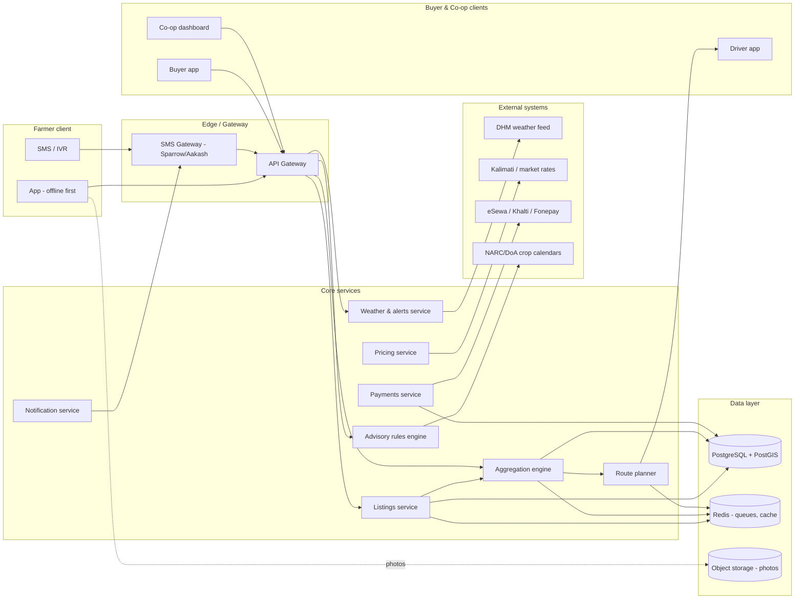
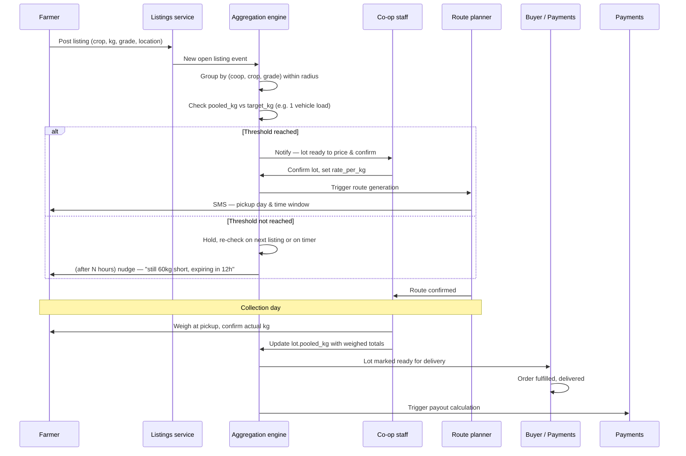
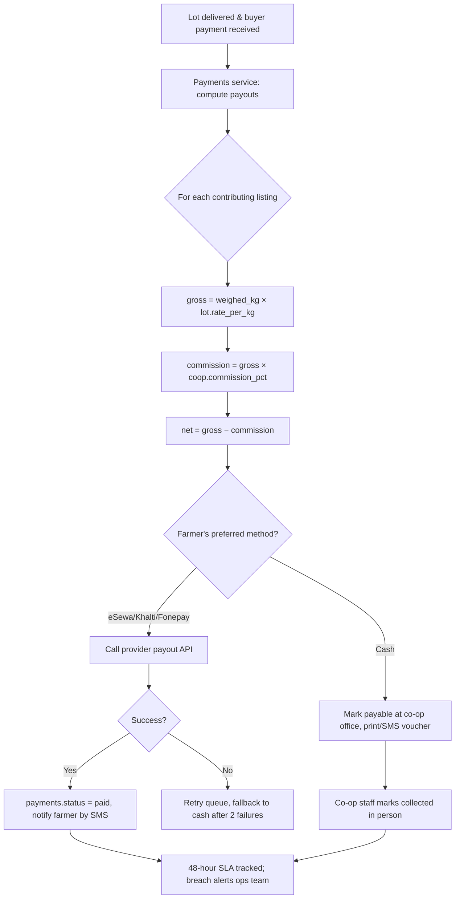

# Kisan Bazar — Backend Architecture

Database schema, aggregation logic, and payment flow for the farmer-to-market platform. This assumes the co-op-first model from the prototype: farmers list produce, co-ops pool it into lots, buyers order lots, drivers run fixed routes.

---

## 1. System shape



Key decision baked into this diagram: **listings and aggregation are separate services**. A listing is a farmer's individual offer; a lot is what the co-op builds from many listings. Keeping them separate lets a listing exist, wait, get amended, or get withdrawn without touching lot state — and lets one farmer's produce potentially span two lots (e.g. grade A goes to a premium buyer, grade B to a wholesale lot).

---

## 2. Database schema (PostgreSQL + PostGIS)

Core entities only — trimmed for clarity, but real enough to build against. `geography(Point,4326)` is used everywhere spatial queries matter, since Nepal's north-south distances are short enough that geometry vs. geography error is negligible, but geography keeps distance math in meters without a manual SRID transform.

```sql
-- ========== IDENTITY ==========

CREATE TABLE users (
    id            uuid PRIMARY KEY DEFAULT gen_random_uuid(),
    phone         text UNIQUE NOT NULL,          -- primary login, works for feature phones
    full_name     text NOT NULL,
    role          text NOT NULL CHECK (role IN ('farmer','buyer','coop_staff','driver','admin')),
    preferred_lang text NOT NULL DEFAULT 'ne',    -- ne / en / mai / bho / awa / thr
    ward_id       int REFERENCES wards(id),
    location      geography(Point,4326),          -- farm/business location
    created_at    timestamptz NOT NULL DEFAULT now(),
    is_active     boolean NOT NULL DEFAULT true
);

CREATE TABLE wards (
    id            serial PRIMARY KEY,
    district      text NOT NULL,
    province      text NOT NULL,
    municipality  text NOT NULL,
    ward_no       int NOT NULL,
    boundary      geography(Polygon,4326),
    elevation_band text CHECK (elevation_band IN ('terai','inner_terai','midhill','highhill','mountain')),
    river_basin   text                             -- koshi / bagmati / gandaki / karnali / mahakali
);
CREATE INDEX wards_boundary_gix ON wards USING gist (boundary);

CREATE TABLE cooperatives (
    id            uuid PRIMARY KEY DEFAULT gen_random_uuid(),
    name          text NOT NULL,
    registration_no text,
    ward_id       int REFERENCES wards(id),
    location      geography(Point,4326),
    phone         text,
    commission_pct numeric(4,2) NOT NULL DEFAULT 8.00,   -- co-op's cut, transparent to farmers
    payout_method text NOT NULL DEFAULT 'esewa'
);

CREATE TABLE coop_members (
    coop_id       uuid REFERENCES cooperatives(id),
    farmer_id     uuid REFERENCES users(id),
    joined_at     timestamptz NOT NULL DEFAULT now(),
    PRIMARY KEY (coop_id, farmer_id)
);

-- ========== CATALOG ==========

CREATE TABLE crops (
    id            serial PRIMARY KEY,
    name_ne       text NOT NULL,
    name_en       text NOT NULL,
    category      text,                             -- cereal / vegetable / cash_crop / fruit / pulse
    unit          text NOT NULL DEFAULT 'kg',
    shelf_life_hours int,                            -- drives collection urgency
    grades        text[] NOT NULL DEFAULT '{A,B,C}'
);

CREATE TABLE land_types (
    id   serial PRIMARY KEY,
    code text UNIQUE NOT NULL,       -- khet / bari / pakho / balaute
    name_ne text, name_en text
);

-- crop calendar: which crop can be sown, where, on what land, in which BS month
-- this is the table the advisory engine queries — must be sourced from NARC/DoA, versioned
CREATE TABLE crop_calendar_rules (
    id              serial PRIMARY KEY,
    crop_id         int REFERENCES crops(id),
    elevation_band  text NOT NULL,
    land_type_code  text REFERENCES land_types(code),
    sow_months_bs   int[] NOT NULL,        -- 0=Baisakh .. 11=Chaitra
    duration_days   int,
    source          text NOT NULL,          -- e.g. 'NARC 2081 crop calendar v3'
    source_url      text,
    reviewed_at     date,
    active          boolean NOT NULL DEFAULT true
);

-- ========== LISTINGS & AGGREGATION ==========

CREATE TABLE listings (
    id            uuid PRIMARY KEY DEFAULT gen_random_uuid(),
    farmer_id     uuid REFERENCES users(id) NOT NULL,
    coop_id       uuid REFERENCES cooperatives(id),
    crop_id       int REFERENCES crops(id) NOT NULL,
    grade         text NOT NULL,
    quantity_kg   numeric(8,2) NOT NULL CHECK (quantity_kg > 0),
    quantity_committed_kg numeric(8,2) NOT NULL DEFAULT 0,  -- how much is already inside a lot
    asking_rate   numeric(10,2),                    -- optional; else co-op sets at weigh-in
    photo_url     text,
    location      geography(Point,4326) NOT NULL,
    status        text NOT NULL DEFAULT 'open'
                  CHECK (status IN ('open','partially_pooled','pooled','withdrawn','expired')),
    created_via   text NOT NULL DEFAULT 'app' CHECK (created_via IN ('app','sms','ivr','coop_staff')),
    created_at    timestamptz NOT NULL DEFAULT now(),
    expires_at    timestamptz NOT NULL              -- auto-expire based on crop shelf_life_hours
);
CREATE INDEX listings_location_gix ON listings USING gist (location);
CREATE INDEX listings_open_crop_idx ON listings (crop_id, status) WHERE status IN ('open','partially_pooled');

CREATE TABLE lots (
    id            text PRIMARY KEY,                 -- human code, e.g. 'KVR-118'
    coop_id       uuid REFERENCES cooperatives(id) NOT NULL,
    crop_id       int REFERENCES crops(id) NOT NULL,
    grade         text NOT NULL,
    target_kg     numeric(8,2),                      -- e.g. one vehicle load
    pooled_kg     numeric(8,2) NOT NULL DEFAULT 0,
    rate_per_kg   numeric(10,2),                      -- locked once lot is priced
    status        text NOT NULL DEFAULT 'forming'
                  CHECK (status IN ('forming','ready','routed','collected','delivered','settled','cancelled')),
    collection_date date,
    created_at    timestamptz NOT NULL DEFAULT now()
);

CREATE TABLE lot_listings (                          -- join: which listings feed which lot
    lot_id        text REFERENCES lots(id),
    listing_id    uuid REFERENCES listings(id),
    kg_contributed numeric(8,2) NOT NULL,
    weighed_kg    numeric(8,2),                       -- actual weight at pickup, may differ
    PRIMARY KEY (lot_id, listing_id)
);

-- ========== ORDERS ==========

CREATE TABLE orders (
    id            uuid PRIMARY KEY DEFAULT gen_random_uuid(),
    buyer_id      uuid REFERENCES users(id) NOT NULL,
    lot_id        text REFERENCES lots(id) NOT NULL,
    quantity_kg   numeric(8,2) NOT NULL,
    unit_rate     numeric(10,2) NOT NULL,
    delivery_address text,
    delivery_location geography(Point,4326),
    status        text NOT NULL DEFAULT 'placed'
                  CHECK (status IN ('placed','confirmed','out_for_delivery','delivered','cancelled')),
    created_at    timestamptz NOT NULL DEFAULT now()
);

-- ========== LOGISTICS ==========

CREATE TABLE routes (
    id            uuid PRIMARY KEY DEFAULT gen_random_uuid(),
    coop_id       uuid REFERENCES cooperatives(id),
    driver_id     uuid REFERENCES users(id),
    vehicle_desc  text,
    route_date    date NOT NULL,
    status        text NOT NULL DEFAULT 'planned'
                  CHECK (status IN ('planned','in_progress','completed'))
);

CREATE TABLE route_stops (
    id            uuid PRIMARY KEY DEFAULT gen_random_uuid(),
    route_id      uuid REFERENCES routes(id),
    lot_id        text REFERENCES lots(id),
    farmer_id     uuid REFERENCES users(id),
    stop_order    int NOT NULL,
    planned_time  time,
    actual_time   timestamptz,
    location      geography(Point,4326)
);

-- ========== PAYMENTS ==========

CREATE TABLE payments (
    id            uuid PRIMARY KEY DEFAULT gen_random_uuid(),
    lot_id        text REFERENCES lots(id),
    farmer_id     uuid REFERENCES users(id) NOT NULL,
    listing_id    uuid REFERENCES listings(id),
    gross_amount  numeric(10,2) NOT NULL,
    coop_commission numeric(10,2) NOT NULL,
    net_amount    numeric(10,2) NOT NULL,
    method        text NOT NULL CHECK (method IN ('esewa','khalti','fonepay','cash')),
    provider_txn_id text,
    status        text NOT NULL DEFAULT 'pending'
                  CHECK (status IN ('pending','paid','failed')),
    initiated_at  timestamptz NOT NULL DEFAULT now(),
    settled_at    timestamptz
);

-- ========== WEATHER & ALERTS ==========

CREATE TABLE weather_bulletins (
    id            uuid PRIMARY KEY DEFAULT gen_random_uuid(),
    source        text NOT NULL,                     -- 'DHM' / 'open-meteo' / 'ICIMOD'
    severity      text NOT NULL CHECK (severity IN ('info','advisory','warning','severe')),
    hazard_type   text,                                -- rain / hail / flood / coldwave / lightning
    affected_wards int[],                              -- ward ids, or basin-level if broad
    river_basin   text,
    message_ne    text NOT NULL,
    message_en    text NOT NULL,
    valid_from    timestamptz NOT NULL,
    valid_to      timestamptz NOT NULL,
    created_at    timestamptz NOT NULL DEFAULT now()
);

CREATE TABLE alert_deliveries (
    id            uuid PRIMARY KEY DEFAULT gen_random_uuid(),
    bulletin_id   uuid REFERENCES weather_bulletins(id),
    user_id       uuid REFERENCES users(id),
    channel       text NOT NULL CHECK (channel IN ('push','sms','ivr')),
    sent_at       timestamptz,
    status        text NOT NULL DEFAULT 'queued'
);
```

**Why a few of these choices:**

- `expires_at` on listings, derived from `crops.shelf_life_hours` — a tomato listing that sits unaggregated for 36 hours should auto-expire and notify the farmer, not silently rot in the database the way the produce would rot in the field.
- `crop_calendar_rules.source` and `reviewed_at` are mandatory, not optional. Advisory content is a liability surface (see §5) — every rule must trace to NARC or DoA and get a re-review date.
- `payments.coop_commission` is stored as its own column so a farmer can be shown gross vs. net honestly — the prototype's "difference vs. middleman" screen depends on this being transparent, not buried in the rate.

---

## 3. Aggregation engine — the core logic

This is the piece that actually differentiates the product. Naive "listing marketplace" apps fail here; this is where a co-op earns its place instead of being disintermediated.



**The threshold logic**, in plain terms — this runs as a scheduled job plus an event trigger on every new listing:

1. Group all `open` / `partially_pooled` listings by `(coop_id, crop_id, grade)` where the farmer's `location` is within the co-op's typical collection radius (start at 15km, tune per district — hill co-ops need wider radii than Terai ones because roads are sparser).
2. Sum `quantity_kg` across the group.
3. Compare against a **target**: either a fixed vehicle-load threshold (e.g. 300kg for a pickup) or a **standing buyer commitment** (a hotel that pre-ordered 200kg of tomato weekly — this is why institutional buyers matter, per the earlier rollout plan: they make the target predictable instead of speculative).
4. If met, notify co-op staff to confirm and price the lot — a human sets `rate_per_kg`, because rate-setting is a trust-sensitive decision that should not be fully automated in a low-trust-of-tech environment.
5. If not met after a configurable window (default: half the crop's shelf life), send farmers a specific, actionable nudge — not "wait," but "60kg short, 12 hours left" — and give the co-op the option to lower the threshold or merge with a neighboring collection point.
6. Once confirmed, hand off to the route planner, which does a simple nearest-neighbor or 2-opt TSP over the stop list — Nepal's collection routes rarely exceed 8–10 stops, so an exact or near-exact solver is cheap; no need for a heavy VRP library at this scale.

**Grade handling**: a single listing can split across lots. A farmer's 40kg of cauliflower might yield 30kg grade A (goes into a premium hotel-bound lot) and 10kg grade B (goes into a wholesale lot). `lot_listings.kg_contributed` tracks this per-lot, so `listings.quantity_committed_kg` is the sum across all lots it feeds, and a listing is only `pooled` (fully closed) once committed equals total.

---

## 4. Payment flow



Two things worth calling out because they're easy to get wrong in a first build:

- **Never let payout be gated on the buyer's payment clearing.** Structurally separate "buyer paid the platform" from "farmer gets paid." The co-op/platform should front the 48-hour payout SLA and carry buyer-side collection risk itself — a farmer who waits on a slow institutional buyer's invoice cycle will not trust the app a second time.
- **Cash is a first-class path, not a fallback UI state.** The schema above treats it as an equal `method`, not an error case — because in year one, a large share of farmers will choose it deliberately.

---

## 5. API surface (representative, not exhaustive)

```
POST   /v1/listings                 create a listing (farmer)
GET    /v1/listings/mine             farmer's own listings + status
POST   /v1/listings/:id/withdraw

GET    /v1/lots?coop_id=&status=    co-op's lots in progress
POST   /v1/lots/:id/confirm          staff confirms + sets rate
POST   /v1/lots/:id/weigh-in         record actual weighed kg per listing

GET    /v1/market/lots               buyer-facing available lots
POST   /v1/orders                    place an order against a lot

GET    /v1/routes/:id                driver's route for the day
POST   /v1/routes/:id/stops/:id/complete

GET    /v1/advisory?ward_id=&land_type=&month_bs=    crop recommendations
GET    /v1/weather/current?ward_id=
POST   /v1/webhooks/dhm-bulletin     ingest DHM feed (internal/authenticated)

POST   /v1/payments/:listing_id/payout-status
POST   /v1/webhooks/esewa            payment provider callback
```

Everything under `/v1/listings`, `/v1/lots`, `/v1/weather` also needs an **SMS/USSD-equivalent path** — a short-code menu (`Reply 1 for today's rate, 2 to list produce, 3 for weather`) hitting the same underlying services, since a meaningful share of farmers, especially above 2000m, will never touch the smartphone app.

---

## 6. Weather ingestion — practical detail

DHM does not currently offer a clean public JSON API the way a commercial weather provider does; bulletins are often published as PDFs/web pages. Realistic pipeline for v1:

1. A scheduled scraper/parser job pulls DHM's public bulletin page and river-basin flood warnings on a short interval (e.g. every 30 min during monsoon, hourly otherwise).
2. Parsed bulletins map to `weather_bulletins`, with `affected_wards` resolved via basin-to-ward or district-to-ward lookup tables (built once, from Survey Department boundaries).
3. Granular short-term forecast (the 5-day strip in the app) comes from a gridded provider like Open-Meteo, queried per-ward centroid and cached for a few hours — this is supplementary, not authoritative; DHM bulletins always win on severity classification.
4. Any `severity IN ('warning','severe')` bulletin triggers `alert_deliveries` for every user whose `ward_id` intersects `affected_wards`, fanned out across push + SMS, with SMS prioritized for older/basic-phone-registered users.

---

## 7. What to build first (v1 slice)

Given the corridor-first rollout from before (e.g. Dhading/Kavre → Kathmandu):

1. `users`, `wards`, `cooperatives`, `coop_members` — identity and geography, nothing works without this.
2. `crops`, `listings`, `lots`, `lot_listings` — the aggregation core, tested with 3–5 co-ops manually confirming lots (skip automated thresholding at first; let staff judge).
3. `weather_bulletins` + SMS delivery — highest trust-building value for lowest build cost, ship before the marketplace transacts real money.
4. `payments` with cash-first, eSewa second.
5. `orders` + `routes` last — once supply-side aggregation is proven, demand and logistics are comparatively easy.

`crop_calendar_rules` and the advisory engine can trail the marketplace by a phase; it's valuable but not revenue-critical, and rushing it risks shipping unreviewed agronomic advice.

---

Want the API contracts fleshed out with request/response bodies for the SMS/USSD menu specifically, or a first-migration script (Alembic/Prisma) to get this schema running?
